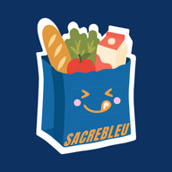

<p align="center">
  
</p>

<h1 align="center">Sacré bleu</h1>
<p align="center">A small shared pantry. Carefully handled changes.</p>
<p align="center">
  <a href="docs/INSTALL.md">Install your own instance</a> ·
  <a href="docs/BACKEND.md">Engineering</a> ·
  <a href="CONTRIBUTING.md">Contribute</a>
</p>

I built Sacré bleu for two people keeping track of the same household pantry: what is left, what was just scanned, and what to buy next. It is an installable web app with French and English interfaces, designed for a phone beside the cupboard.

The scope is deliberately small. The interesting work is making shared changes behave predictably when two phones act at once, a response goes missing, or a backup replaces the inventory.

## Everyday use

- Search and edit products, adjust whole-package quantities, and keep empty products in the catalogue.
- Scan EAN/UPC barcodes with the camera or enter them manually; adjust or undo a scan when its state is still current.
- Share a shopping list with one other account. Adding stock by scan also reduces linked shopping quantities.
- Prefill unknown products from Open Food Facts, with editable suggestions and a manual fallback.
- Read the last synchronized pantry offline, export JSON, and restore through an owner-only preview and confirmation flow.

No offline writes. Shopping suggestions require an explicit action. Private photo uploads and password recovery screens are not implemented. Choose Français or English in settings; this display preference stays on your device. The local demo is separate from the shared pantry.

## Where the engineering is

React and strict TypeScript run in a Vite PWA. Supabase provides Auth, PostgreSQL and an authenticated Edge Function for Open Food Facts; Cloudflare Pages serves the static frontend. Synchronization uses visible-page polling, not Realtime.

| Decision                                     | Implementation and evidence                                                                                                                                                                                                       |
| -------------------------------------------- | --------------------------------------------------------------------------------------------------------------------------------------------------------------------------------------------------------------------------------- |
| Let PostgreSQL arbitrate shared changes      | Reserve-level locks serialize mutations; stock and linked shopping updates commit together. [RPC contracts and concurrency tests](docs/BACKEND.md).                                                                               |
| Retry an intention without applying it twice | A request UUID identifies the payload; effects and receipt share a transaction. After an uncertain response, the client retains that UUID and blocks new writes until recovery. [Client store](src/backend/store.ts).             |
| Reject stale corrections                     | Scan compensation checks revisions and versions. It changes the affected rows rather than restoring an old global snapshot. [SQL implementation](supabase/migrations/20261026000300_reserve_transactions.sql).                    |
| Enforce authorization below the UI           | RLS protects reads; authorized RPCs are the only shared write path. Explicit grants and empty privileged-function search paths keep the boundary visible. [Database tests](supabase/tests/database/01_security_and_business.sql). |
| Treat restore as a transaction               | Validate twice, check the preview revision, remap IDs and replace stock/catalogue/shopping atomically. [Recovery contract](docs/PHASE5.md).                                                                                       |
| Make offline access explicit                 | Account/project-scoped browser copies are read-only and cleared on signout; they are unencrypted and cannot discover remote revocation while offline. [Privacy and limits](docs/PHASE5.md).                                       |

Pure product rules live in [`src/model.ts`](src/model.ts), browser persistence in [`src/storage.ts`](src/storage.ts), and the typed backend adapter in [`src/backend/`](src/backend/). See the [documentation index](docs/README.md) for the current guides and preserved development history.

## Run it and check it

With Node.js 24+ and npm:

```sh
npm ci
npm run dev -- --strictPort
```

Open [127.0.0.1:5173](http://127.0.0.1:5173) and choose **Essayer la démonstration sur cet appareil** for an isolated local demo. A shared local instance also needs Docker and Supabase; hosted installation uses your own private resources. Follow [INSTALL.md](docs/INSTALL.md), including private account provisioning and first-reserve initialization.

```sh
npm test
npm run typecheck
npm run build
npm run format:check
```

PR CI also exercises a fresh local database, pgTAP authorization/rollback assertions, multi-connection contention, Auth/API, the shared SDK, and browser update/offline/restore journeys. These tests cover failure paths as well as successful operations; they do not certify every phone camera or a fresh hosted installation. [Commands, coverage and remaining device checks](docs/TESTING.md).

## Contributing, credits and license

Issues and focused pull requests are welcome. This is a personal project maintained in spare time, with no guaranteed support or acceptance of changes. Start with [CONTRIBUTING.md](CONTRIBUTING.md); report vulnerabilities through the private route described in [SECURITY.md](SECURITY.md).

Mascot by **Eloane ROURE**, redistributed with permission under MIT. The existing blue-and-cream artwork is retained. [Artwork provenance](assets/branding/README.md).

Project code and documentation are [MIT licensed](LICENSE). Bundled libraries retain their own [notices](THIRD_PARTY_NOTICES.md); Open Food Facts data and images retain their separate licenses. The creator's separate MIT notice is preserved with the [artwork](assets/branding/LICENSE). See the [release checklist](docs/RELEASE.md) for publication steps and verification limits.
