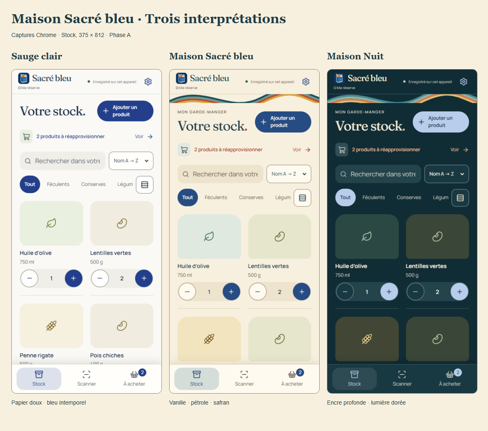

# Phase A — Maison Sacré bleu

Frontend visual identity, based on `main` at `ca23b0a` (2026-11-01). No business rule, backend, SQL, Auth flow, hosted configuration or dependency changes. No new motion design. The original mascot, bundled Fraunces/Manrope fonts and product image sources/attribution remain in place.

## Art direction

The supplied flowing, multicoloured print references inform an original vector ribbon, warm paper surfaces and a restrained complementary palette. The ribbon has its own narrow space below the header and on account screens; it never sits behind a product or control. Rounded arch-like media frames recall grocery labels. Category backgrounds distinguish grain, preserves, legumes and groceries when no photograph exists. Real photographs use a neutral contain-fit frame, without blending, filtering or recolouring.

Sauge clair preserves the established ivory/sage surfaces and royal blue actions. Maison Sacré bleu combines vanilla paper, petrol typography, historical blue actions, terracotta editorial punctuation and saffron details. Maison Nuit uses ink/petrol layers, warm ivory text, soft blue actions and warm gold/terracotta accents. Its pale photograph frame deliberately separates white-background package photos from the dark surroundings.

Fraunces supplies the wordmark and headings; Manrope supplies controls and body copy. Maison introduces an editorial stock eyebrow, more expressive media corners and a slightly larger stock title. The four-digit counter uses tabular body-sized numerals, with browser geometry assertions at 320px. Settings offer three descriptive, full-width native radio choices with visible keyboard focus. Primary-button icons now inherit their label colour, including in disabled states.

## Palette and roles

`src/theme.css` is the single palette source. Existing legacy names are retained as a compatibility boundary; `src/ui/foundations.css` maps them to semantic component roles without cycles. New status roles are independent of decorative accents. Layout/shape tokens are shared with small deliberate Maison variations; there is no additional theme override stylesheet.

| Role / source token               | Sauge clair | Maison Sacré bleu | Maison Nuit |
| --------------------------------- | ----------- | ----------------- | ----------- |
| Canvas / `--canvas`               | `#faf9f5`   | `#f8f0df`         | `#102c35`   |
| Paper / `--paper`                 | `#fffefa`   | `#fffaf0`         | `#193942`   |
| Inset / `--surface-soft`          | `#f0eee8`   | `#eee3cd`         | `#23444b`   |
| Text / `--text`                   | `#1d314d`   | `#203d46`         | `#f5ead3`   |
| Secondary / `--muted`             | `#5d6773`   | `#68604f`         | `#c1c4b9`   |
| Primary / legacy `--green`        | `#233f8c`   | `#264c83`         | `#b8cdeb`   |
| On primary / `--on-primary`       | `#ffffff`   | `#fffaf0`         | `#142f44`   |
| Selection / `--selected-surface`  | `#e9edf7`   | `#e0e9e4`         | `#304e57`   |
| Control edge / `--control-border` | `#7a8490`   | `#8b8069`         | `#839b9d`   |
| Focus / `--focus`                 | `#3562c1`   | `#285a97`         | `#e6bd70`   |
| Success / `--success-text`        | `#356145`   | `#2e604c`         | `#b0d4ba`   |
| Warning / `--warning-text`        | `#80571d`   | `#7b5416`         | `#f0ce87`   |
| Danger / `--danger-text`          | `#963e35`   | `#a0392c`         | `#ffb8a5`   |
| Disabled / `--disabled-text`      | `#606d58`   | `#625c50`         | `#b6bdb5`   |

Each status has a corresponding surface token. Destructive swipe actions retain their separate red fill/on-red pair. Camera overlays have explicit fixed contrast roles, independent of the palette; the actual stream is untouched. `--signature-*` colours are decorative and never carry state or body text.

## Preference compatibility

The storage key remains `app-reserve.theme.v1`. Available identifiers are exactly `light`, `maison`, `maison-night`; UI names are translated through the typed catalogue.

| Previous stored value                      | Explicit new value                                          |
| ------------------------------------------ | ----------------------------------------------------------- |
| `light`                                    | `light` (Sauge clair)                                       |
| `dark`, `retro-petrol`                     | `maison-night`                                              |
| `auto`                                     | System dark → `maison-night`; otherwise `light`, saved once |
| `slate`, `retro-cream`, missing or invalid | `light`                                                     |
| `maison`, `maison-night`                   | Unchanged                                                   |

The blocking head script performs migration before first paint. React uses the same mapping, covered by parity tests. A migrated Automatic preference no longer follows later OS changes, including after reload. Blocked reads fall back safely to Sauge; blocked migration writes retain the head script's explicit DOM choice for the current session. Persistent choice across restarts is impossible when the browser refuses storage. Failed user selections retain the previous appearance and announce the existing bilingual error. Cross-window storage events still synchronize explicit selections. Stock, language, pending intentions and backup formats do not change.

## Visual evidence

All captures are actual local Chrome renders, with external requests blocked. The baseline captures come from an isolated checkout of `main` at `ca23b0a`, using the same production App, `polish-harness` demo inventory and 375×812 viewport as the new stock/scanner/shopping captures. No private pantry or account data appears. The photographed package is replayed from the existing licensed OFF fixture; see [fixture provenance](../phase7a/PHOTOS.md).

| Surface, 375px     | Before                                  | Sauge clair                                   | Maison Sacré bleu                              | Maison Nuit                                          |
| ------------------ | --------------------------------------- | --------------------------------------------- | ---------------------------------------------- | ---------------------------------------------------- |
| Stock              | [V1.1](screenshots/before-stock.png)    | [View](screenshots/light-stock-375.png)       | [View](screenshots/maison-stock-375.png)       | [View](screenshots/maison-night-stock-375.png)       |
| Scanner            | [V1.1](screenshots/before-scanner.png)  | [View](screenshots/light-scanner-375.png)     | [View](screenshots/maison-scanner-375.png)     | [View](screenshots/maison-night-scanner-375.png)     |
| Shopping           | [V1.1](screenshots/before-shopping.png) | [View](screenshots/light-shopping-375.png)    | [View](screenshots/maison-shopping-375.png)    | [View](screenshots/maison-night-shopping-375.png)    |
| Product sheet      | —                                       | [View](screenshots/light-detail-375.png)      | [View](screenshots/maison-detail-375.png)      | [View](screenshots/maison-night-detail-375.png)      |
| Preferences        | —                                       | [View](screenshots/light-preferences-375.png) | [View](screenshots/maison-preferences-375.png) | [View](screenshots/maison-night-preferences-375.png) |
| Offline/read-only  | —                                       | [View](screenshots/light-offline-375.png)     | [View](screenshots/maison-offline-375.png)     | [View](screenshots/maison-night-offline-375.png)     |
| Real photo fixture | —                                       | [View](screenshots/light-photo-375.png)       | [View](screenshots/maison-photo-375.png)       | [View](screenshots/maison-night-photo-375.png)       |

The same six main surfaces are captured at 320×568, 430×932 and 1100×900 for every appearance. Further captures cover checked shopping, empty search, English settings/editor, authentication, long product names without photos, compact lists and focus at 320px. Names follow `<theme>-<surface>-<width>.png` in [screenshots](screenshots). [Before dark stock](screenshots/before-dark.png) compares the former dark sage composition with Maison Nuit. [Additional regression captures](regression) include active synthetic camera, swipe deletion, Undo and uncertain-write recovery.

## Verification

- `npm test`: 359 Vitest tests across 28 files and 5 configuration tests pass. Theme tests cover all old values, explicit selection, head-script/React parity, native control scheme, browser chrome, blocked reads/writes and preserved unrelated preferences.
- `npm run typecheck`, `npm run build`, `npm run format:check`: pass on the delivered frontend; the build retains the existing chunk-size advisory.
- `npm run test:themes:browser`: all three appearances, real settings selection, persisted migration and OS changes, FR/EN, six surfaces at four widths, modal/document overflow, four-digit control geometry, missing photos, long text, compact lists, focus, real photo fixture and comparison sheet. Added to PR CI.
- `npm run test:polish:browser`: confirmed shared writes, shopping deletion/Undo, gesture arbitration, concurrent accumulation, recovery/offline, FR/EN, explicit themes, focus and synthetic camera across mobile/landscape/desktop pass.
- `npm run test:ui:browser`, `npm run test:i18n:browser`, `node scripts/browser/shop-scanner.integration.mjs`, `node scripts/browser/finishing.integration.mjs`: navigation/keyboard, bilingual forms/storage failure, scanner/shopping semantics and backup/restore warning surfaces pass.

[Computed contrast measurements](contrasts.json) are regenerated from browser-resolved tokens in linear sRGB. Text, primary labels, selections, muted text, status messages and disabled text are asserted at ≥4.5:1; control borders and focus against their surfaces at ≥3:1. These tests measure the listed pairs, not an exhaustive accessibility certification. Inspection corrected a 4.35:1 disabled-text pair and a legacy icon colour that bypassed disabled tokens.

Physical iOS/Android, installed-PWA chrome/safe areas, live optical barcode recognition and assistive technology were not tested. Camera browser tests use a synthetic device/decoder. Existing Vite main-chunk size advisory remains (about 660 kB uncompressed); the decoder stays lazy-loaded. No deployment, merge or hosted mutation is included. The pending Phase B motion work remains separate.
