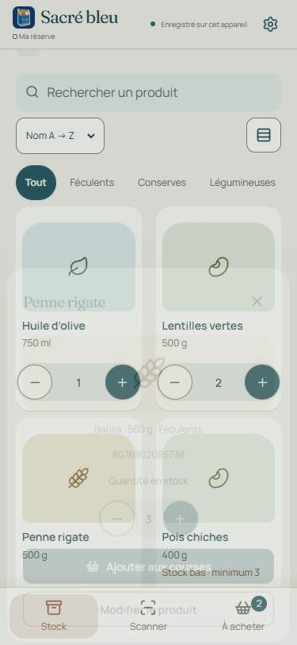
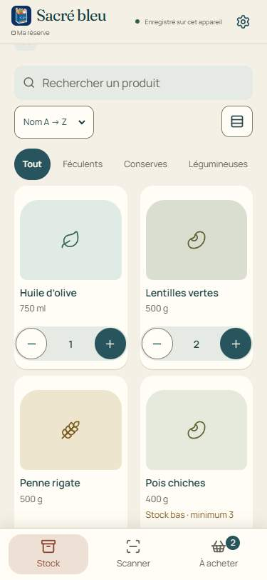
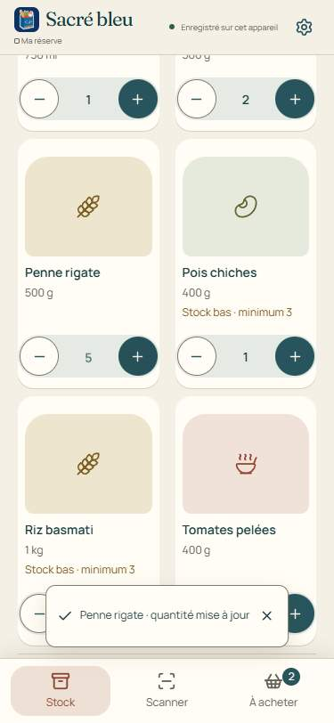
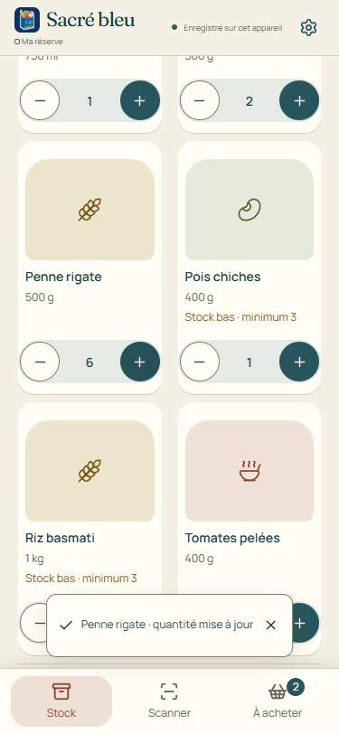
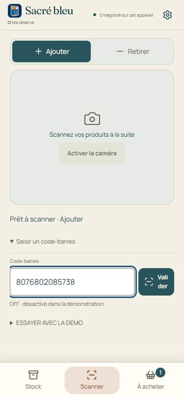

# after · CPU ×4

375 × 812, Maison, Chrome 156.0.8078.74. Successive captured frames, in capture order; times are relative to the first capture in each scenario. These are sparse temporal samples, not a 60 FPS video. See [raw timings](timings.json).

## navigation

| 0 ms                                                                | 119 ms                                                                | 333 ms                                                                | 450 ms                                                                |
| ------------------------------------------------------------------- | --------------------------------------------------------------------- | --------------------------------------------------------------------- | --------------------------------------------------------------------- |
|  |  |  |  |

## sheet

| 0 ms                                                      | 144 ms                                                      | 266 ms                                                      | 369 ms                                                      | 478 ms                                                      | 585 ms                                                      | 697 ms                                                      |
| --------------------------------------------------------- | ----------------------------------------------------------- | ----------------------------------------------------------- | ----------------------------------------------------------- | ----------------------------------------------------------- | ----------------------------------------------------------- | ----------------------------------------------------------- |
|  |  |  |  |  |  |  |

## quantity

| 0 ms                                                            | 237 ms                                                            | 392 ms                                                            | 504 ms                                                            |
| --------------------------------------------------------------- | ----------------------------------------------------------------- | ----------------------------------------------------------------- | ----------------------------------------------------------------- |
|  |  |  |  |

## shopping

| 0 ms                                                            | 190 ms                                                            | 287 ms                                                            | 390 ms                                                            | 579 ms                                                            | 727 ms                                                            |
| --------------------------------------------------------------- | ----------------------------------------------------------------- | ----------------------------------------------------------------- | ----------------------------------------------------------------- | ----------------------------------------------------------------- | ----------------------------------------------------------------- |
|  |  |  |  |  |  |

## scanner

| 0 ms                                                          | 378 ms                                                          | 582 ms                                                          | 715 ms                                                          | 842 ms                                                          |
| ------------------------------------------------------------- | --------------------------------------------------------------- | --------------------------------------------------------------- | --------------------------------------------------------------- | --------------------------------------------------------------- |
|  |  |  |  |  |
