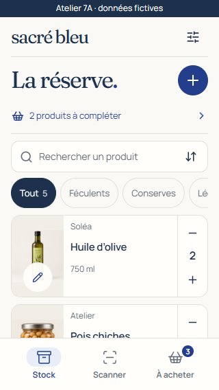
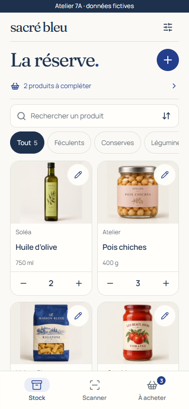
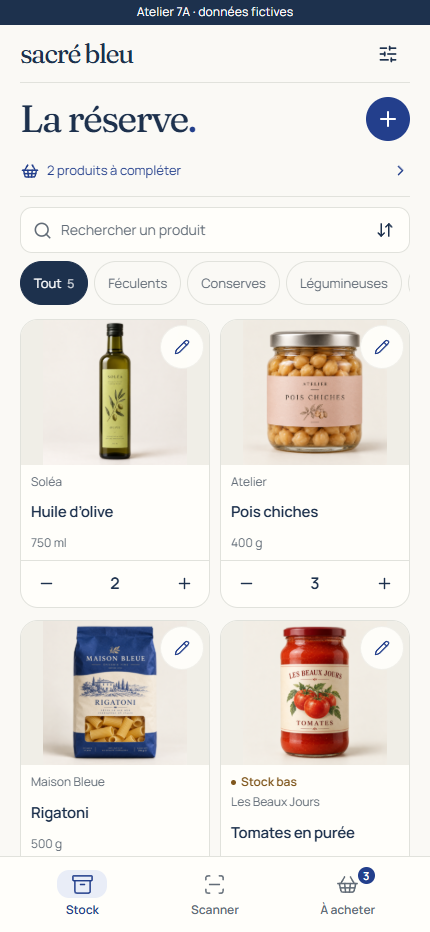
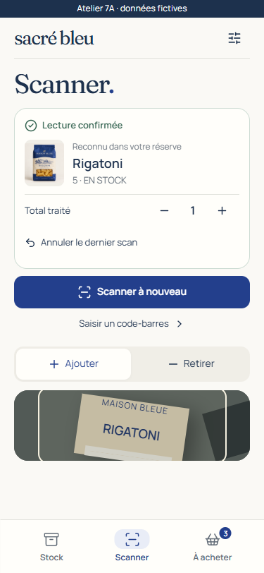
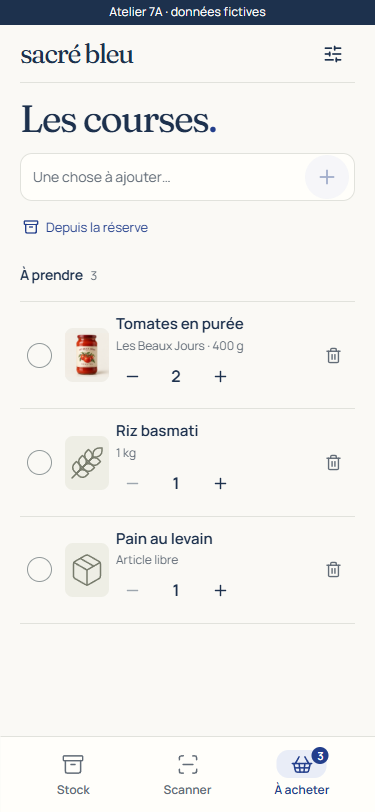
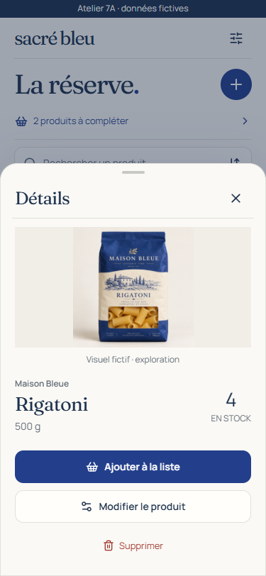
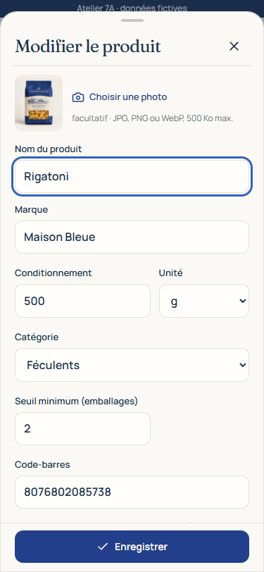
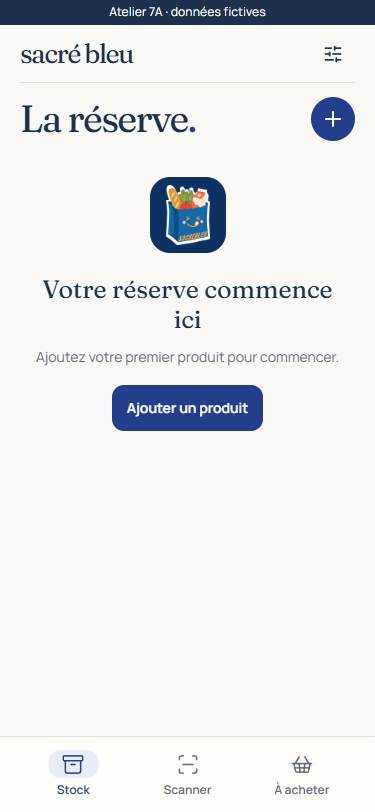

# Sacré bleu V1.1 · Phase 7A / 7A.1

**Current review: [Phase 7A.1 refinement, before/after and full screen matrix](REFINEMENT.md). No design approval, integration or deployment is implied.**

The direction is **L’épicerie bleue**: an ivory canvas, ink-blue typography, restrained cobalt actions and generous product photographs. A pantry should feel like a carefully arranged cupboard. Its navigation still has exactly three destinations: Stock, Scanner and À acheter.

## Inspect the prototype

From the repository root, with Node 24+ and installed dependencies:

```sh
npm ci
npm run dev:7a
```

Open **http://127.0.0.1:5197/**. Stop with Ctrl+C. No environment file, account, Supabase, OFF request, camera or household data is needed. The ribbon identifies a simulation. Reload resets all products, photographs and preferences. Language is in memory and starts in French.

```sh
npm run typecheck:7a
npm run build:7a
npm run build
npm run test:7a:browser
```

The browser check uses installed Chrome (`npx playwright install chrome` if needed), starts its own loopback server if port 5197 is free, and captures evidence. Run `npm run build` first for its production-isolation assertions. The standalone build goes to ignored `.tmp/phase7a-build/`. Its own Vite config has no PWA plugin, public-directory copying or environment-file loading. The normal production entry point/configuration never imports the prototype, its catalogue or its assets.

Source: `explorations/7a/src/`; paired presentation strings: `src/i18n/phase7a.ts`. This separate, typed catalogue reuses existing strings and does not enter the V1 production import graph. Existing model functions drive stock, product, scan, undo and linked-shopping simulations. React memory replaces persistence; a 550 ms simulated receipt precedes every successful change. There are no new dependencies or lockfile changes. The refinement adds locally bundled open-licence fonts and attributed public OFF image snapshots; runtime remains loopback-only.

## Review walkthrough

1. Open Stock at 375 × 812 or 430 × 932. Browse photographs; search `huile`; filter categories; use the sort icon inside search to switch alphabetical/category order. Zero-stock products remain at the bottom.
2. Adjust stock. The count stays unchanged while saving; controls lock. Open settings, choose failure on next save, close, and repeat: no count changes. Offline and uncertain states similarly block writes. These states are explicit review controls, not real network detection.
3. Tap a product photo/name → detail sheet → edit, or tap its pencil for direct editing. Change its name, category, package or minimum. Select a JPEG/PNG/WebP under 500 KB and 4096 px per dimension; the picture remains local to this session. Save only updates metadata for an existing product. Deletion has a separate confirmation and detaches linked shopping through the existing model.
4. Start a swipe across the heading, product photograph or product name; move horizontally across roughly a fifth of the content width. Vertical motion, quantity/edit controls, category strips, system edges, a sheet and an active scanner stay protected. Neighboring real panes track the finger continuously; inactive panes are inert. The bottom bar and keyboard buttons provide the same destinations, without wrapping.
5. On Scanner, choose Ajouter/Retirer, explicitly start simulation, then simulate a reading. The known Rigatoni barcode uses the existing scan rules, including linked shopping reduction on positive movement. The confirmed result offers absolute processed-total adjustments and undo. A later mutation invalidates this correction. Use manual code `1234567890123` for a new fictitious product; positive-scan undo keeps its catalogue entry at zero.
6. On À acheter, add free text or explicitly choose a product, decrease/increase quantities, check/uncheck, remove rows and clear completed entries. Checked rows stay in a separate group. A product-linked entry has an image; free text has a deliberately neutral image slot. Suggestions require an explicit addition.
7. In settings, switch Français/English and try empty, loading, offline, failed-save and uncertain states. Empty clears catalogue/shopping together; the image selector loads a mixed-condition review set. Reset examples when finished. The original mascot appears in empty states and credits without redrawing.

## Visual evidence

Actual Chrome rendering, not generated UI mockups. See [verification and limits](EVIDENCE.md).

| Compact phone · 320 × 568                       | Phone · 375 × 812                       | Larger phone · 430 × 932                       |
| ----------------------------------------------- | --------------------------------------- | ---------------------------------------------- |
|  |  |  |

| Scanner                                 | Confirmed scan, immediately visible             | Shopping                                  |
| --------------------------------------- | ----------------------------------------------- | ----------------------------------------- |
|  |  |  |

| Product detail                        | Product editing                        | Empty state                         |
| ------------------------------------- | -------------------------------------- | ----------------------------------- |
|  |  |  |

Additional evidence: [English shopping](screenshots/shopping-en-375.png), [offline stock](screenshots/offline-375.png), [wide browser](screenshots/inventory-900.png). Editing sheets scroll internally, with a sticky save action and focused-field clearance. Every primary screen and state now has captures at all four requested widths in the refinement matrix.

## Assessment of V1

These are verified source findings, not claims from a usability study:

| Finding                                                                                                                                                         | Evidence                                                 | Design response                                                                                                                                                                                                    |
| --------------------------------------------------------------------------------------------------------------------------------------------------------------- | -------------------------------------------------------- | ------------------------------------------------------------------------------------------------------------------------------------------------------------------------------------------------------------------ |
| The three destinations and bottom navigation already exist. Desktop uses a separate sidebar/topbar hierarchy.                                                   | `src/App.tsx`, `src/style.css`                           | Preserve three destinations; use the same bottom-bar structure at wide widths and bound the content instead of introducing dashboard furniture.                                                                    |
| Swipes start only in 32 px screen-edge strips and commit after 64 px.                                                                                           | `src/usePageSwipe.ts`                                    | Explore content-area intent detection, with system edges reserved. Keep V1 hook unchanged in 7A.                                                                                                                   |
| Images already prefer personal `photo`, then validated OFF URL, then a category icon. Shared uploads are disabled.                                              | `src/components.tsx`, `src/productInfo.ts`               | Elevate existing imagery into stable contain-fit image areas; retain provenance and fallback semantics. Private storage needs separate work.                                                                       |
| Stock view has title/description, summary metrics, restock banner, search/sort, categories, table heading and footnotes. Many desktop labels use 9–12 px sizes. | `src/App.tsx`, `src/style.css`                           | Remove summary metrics and explanatory footnotes from the primary composition. A single actionable restock strip leads to shopping; the product list is the focus.                                                 |
| Product rows open an editing form directly. Stock changes are already separate from metadata updates.                                                           | `src/App.tsx`, `src/components.tsx`                      | Introduce a detail sheet for image, quantity and shopping action, with editing one level deeper. This adds one step to metadata edits; review whether frequent editors would benefit from a direct shortcut in 7B. |
| Scanner activation, pause, torch/camera choice, manual fallback, presentation locking and compensation already exist.                                           | `src/CameraScanner.tsx`, scanner modules, `src/model.ts` | Give primary scan controls a clearer hierarchy. Do not remove diagnostics, manual entry or compensation constraints during integration.                                                                            |
| Shared state distinguishes confirmed, pending, uncertain and offline data; appearance has six stored preferences.                                               | `src/backend/store.ts`, `src/Root.tsx`, `src/theme.ts`   | Preserve these contracts. Concise status strips must still expose freshness and recovery actions. Do not change theme identifiers.                                                                                 |

Design hypotheses to validate: imagery may improve recognition but reduce visible product density; shorter copy may reduce reading effort but must remain clear to first-time users; content swipes may feel easier but need physical-device false-positive testing; a detail sheet may improve discoverability of product-linked shopping. The 320 px iteration already showed the density tradeoff: its short viewport uses compact image rows, while taller phones keep a two-column grid.

## Visual foundation

| Layer               | Proposed decision                                                                                                                                                                                                                                        |
| ------------------- | -------------------------------------------------------------------------------------------------------------------------------------------------------------------------------------------------------------------------------------------------------- |
| Type                | Fraunces for wordmark/titles and Manrope for interface/data, locally served under the bundled SIL OFL notices. System serif/sans fallbacks remain. About 264 KB original TTF payload is prototype-only; production WOFF2/subsetting remains a decision.  |
| Hierarchy           | 34–38 px page titles, 25–27 px sheet/detail titles, 14–16 px names/actions, 12–13 px supporting text. Redundant editorial labels and the oversized shopping count are removed.                                                                           |
| Palette             | Canvas `#faf9f5`, surface `#fffefa`, inset `#f0eee7`, ink `#1d314d`, secondary ink `#626c77`, brand `#233f8c`, brand tint `#e9edf7`. Warning `#80571d` on `#f6e8cc`; danger `#a33b31`; confirmed `#356451`. Text/icons always accompany semantic colour. |
| Geometry            | 4 px spacing unit; 18–24 px phone gutters, 36 px wide gutters; 12–20 px radii for controls/cards; 28 px sheets. Default touch targets 44 px or more, 50 px primary actions. Safe-area padding on bottom navigation.                                      |
| Imagery             | Reusable contain-fit area, neutral inset background, stable aspect ratio and lazy decode. Portrait packages remain whole. No invented crops of labels; no photographic treatment for free text. Failed images resolve to a reserved category slot.       |
| Navigation          | Three equally reachable, labelled bottom buttons. Icon tint/pill, label and `aria-current` identify selection. Shopping badge counts unchecked rows, not units. No extra primary destinations.                                                           |
| Surfaces            | Flat warm canvas, quiet borders and almost no elevation. Shadows belong to transient sheets/feedback. No blur-dependent contrast or decorative gradients.                                                                                                |
| Forms               | Persistent labels, 16 px input text, paired package/unit fields, native selects, visible focus, inline errors. Form values survive a failed simulated save. Quantities are not editable as metadata on existing products.                                |
| Empty/loading/error | Original mascot only in welcoming/empty/credit contexts; reserved image slots and skeleton grid for loading; actionable text for failure/offline/uncertain state. The uncertain state must retain the real UUID recovery contract in 7B.                 |

The synthetic package/personal-photo prompts, public OFF snapshot provenance and font licences are in [the asset record](../../../explorations/7a/ASSETS.md). They are prototype fixtures, not proposed real catalogue data. OFF provenance/licence links must remain on real provider-backed detail/editor views. Personal photos must not inherit OFF image attribution.

## Gesture and motion contract

The refined standalone hook allows single-touch navigation on ordinary content and explicitly marked product-photo/name buttons. Tap opens details; horizontal intent captures a swipe and suppresses its compatibility click. Quantity/edit controls, fields, links, filter strips, viewfinder, system edges, open sheets, pending writes and dirty drafts remain protected. The 24 px outer edge is reserved for system/browser gestures. Zoom is not disabled. Each pane scrolls independently; inactive panes are inert and hidden from assistive technology.

Motion uses a single track with 1:1 finger translation and an actually rendered neighboring pane, settling in 280 ms with resistance at the first/last destination. Presentation-only calibration is exercised in browser and intention tests: 12 px direction lock, ratio 1.8, distance 20% clamped to 56–96 px, or a ≥40 px short flick faster than 0.55 px/ms. These remain device-calibration candidates, not physical-phone acceptance. See [the browser gesture ownership model](https://developer.mozilla.org/en-US/docs/Web/CSS/Reference/Properties/touch-action) and [refinement trade-offs](REFINEMENT.md).

Press feedback is 110 ms; sheet entry 240 ms. Quantity/check changes wait for confirmation, pending remains immediate, and errors remain actionable. A confirmed scan is its own result-first feedback surface, without an overlapping success toast. Reduced motion removes transitions/animations while retaining status and locks. No new haptic behavior is implemented.

## Secondary-screen inventory for 7B

These are designed coverage specifications, **not visually validated implemented screens**. Settings, sheets, empty, loading and offline examples in the prototype establish the component vocabulary.

| Surface/state                                       | Composition and retained behavior                                                                                                                                                                                                                          |
| --------------------------------------------------- | ---------------------------------------------------------------------------------------------------------------------------------------------------------------------------------------------------------------------------------------------------------- |
| Sign-in / email confirmation / Auth failure         | Quiet wordmark, one serif heading, labelled email/password, single primary action, inline classified error. Retain private provisioning boundaries, local-only signup rules and pre-sign-in language/appearance settings. No new recovery feature implied. |
| Account / two-member reserve                        | Settings sheet sections for account, members and invitations. Show role and confirmed email, targeted invitation expiry and copy/share controls. Keep owner restrictions, fragment handling and signout cleanup intact.                                    |
| Language / appearance                               | Native language names and theme swatches with visible labels and radio state; storage-write error remains announced. Stored selections remain valid; no automatic rewrite to the proposed light palette.                                                   |
| Export                                              | One concise action with last confirmed snapshot date/scope and explicit offline-copy indication. Show success only after successful creation/download initiation; preserve existing size validation.                                                       |
| Restore preview / confirmation                      | File selection → validated summary of affected products/shopping → owner-only destructive confirmation. Retain revision/stale rejection, exact pending intention, replay and conflict recovery. Never replace this with a generic checkmark sheet.         |
| Offline / expired session                           | Dated read-only banner, freshness and refresh affordance; locked mutation controls, readable catalogue, permitted export. Do not present offline as fully synchronized.                                                                                    |
| Uncertain write                                     | Persistent blocking status, original intent context, one recovery action. A refreshed read/receipt is required before success; never offer another blind write.                                                                                            |
| Provider lookup / missing / limited / late response | Stable image skeleton, then OFF-provided suggestion with attribution, or concise manual entry with reason and retry delay. Keep catalogue-first lookup and cancellation protections.                                                                       |
| Product deletion / reset / signout                  | Named target and consequences, clear cancel and destructive action. Preserve shopping detachment and private cleanup. No removal of sensitive confirmations to save space.                                                                                 |
| PWA update / other-window blocker                   | Existing explicit Actualiser/Plus tard decision, concise reason for blocking update, focus-safe prompt. Never reload dirty forms, pending writes or an active scanner automatically.                                                                       |

## Theme adoption without preference migration

7A changes no production theme code or localStorage. In 7B, add semantic aliases at the component boundary: `ink` → existing `text`, `ink-secondary` → `muted`, `brand` → existing primary token, `surface` → `paper`, and explicit on-brand/focus/status/image tokens. First render the new components through existing palettes. Then bind the approved premium palette to the existing `light` identifier only; keep `auto` resolving to system light/dark and retain `dark`, `slate`, `retro-cream`, `retro-petrol`. Audit all palettes for contrast and disabled/focus states even if their art direction is deferred. Do not repurpose preference keys or switch existing users to light. Any renamed theme label is presentation-only and bilingual.

## Next phases and decisions

**7B, only after explicit design approval:** extract tokens/image/stepper/navigation/sheet primitives; integrate Stock and shopping with the existing confirmed shared store; integrate detail/editor and all secondary screens; then replace swipe navigation behind focused regression tests; finally apply scanner composition around its unchanged lifecycle/recognition controllers. Validate every supported palette, French/English, keyboard focus, long user/provider names, 0/9999 quantities, failed images and all synchronization states. Keep the current backend and JSON contracts.

**7C, separately authorized:** physical iPhone/Samsung and installed-PWA gesture/camera/update acceptance; accessibility/performance refinements, image-size optimization and alternate-theme review. If private photos are approved, schedule the separately reviewed [storage/backup work](PHOTOS.md) with its fresh local database, pgTAP, concurrency, Auth/API and regenerated types. Photo work need not block adopting the new UI with existing OFF/fallback images. Conclude with an explicitly approved release-to-main PR; no automatic merge or publication.

Maintainer decisions: approve/revise this visual direction; assess two-column grid versus dense list; accept the extra detail-to-edit step or request a shortcut; choose the default density for short phones; prioritize private photos independently; confirm device gesture thresholds and type fallback after testing. CI success is not design approval.

See [branch/CI safety](SAFETY.md), [private photo proposal](PHOTOS.md) and [actual validation](EVIDENCE.md).
