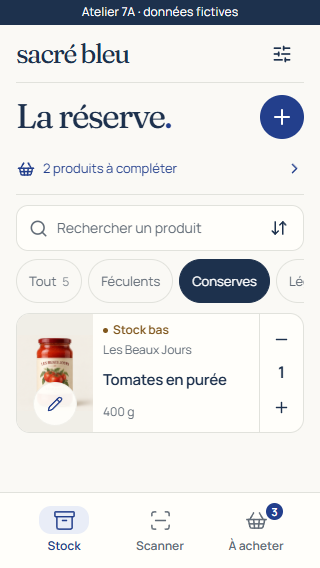
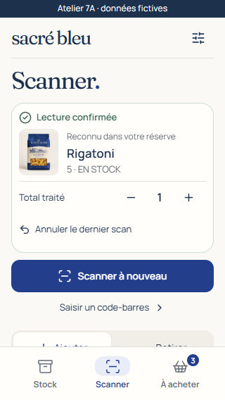

# Phase 7A.1 · focused refinement for visual approval

**L’épicerie bleue is retained. This is a revision of PR #9, not approval of V1.1 and not the start of 7B.** All work stays in the isolated prototype on `feat/v1.1-7a-design`, targeting `release/v1.1`. No production application, hosted configuration, migration, dependency or lockfile changes.

## Before and after

| Area                 | 7A proposal                                                                | 7A.1 refinement                                                                                                                                                                                                                                                                                                                                   |
| -------------------- | -------------------------------------------------------------------------- | ------------------------------------------------------------------------------------------------------------------------------------------------------------------------------------------------------------------------------------------------------------------------------------------------------------------------------------------------- |
| Inventory            | Editorial eyebrow, full restock card, separate list heading/sort row.      | One title, one-line restock link, sort inside search, catalogue count in Tout. The first card appears roughly 115–120 px earlier at 375 px. Exact new positions are saved in [measurements](screenshots/measurements.json).                                                                                                                       |
| Short phone          | Stock-warning badge was hidden by the compact media query.                 | Status is ordinary card content, always at least 12 px, independently of image geometry. Zero stock is explicit even without a configured minimum; low stock uses the same below-minimum comparison as the summary.                                                                                                                               |
| Type                 | Georgia plus system UI; supporting text often 9–11 px.                     | Locally hosted Fraunces display and Manrope interface pairing. Supporting text is 12–13 px, names/actions 14–16 px, page titles 34–38 px. French accents and English layouts are rendered in the browser. No remote font requests.                                                                                                                |
| Shopping             | Oversized counter and explanatory copy; increment-only compact control.    | One list hierarchy with check/uncheck, decrement/increment, removal, completed-row clearing and a product picker. Quantities remain integers; decrement stops at one, explicit changes uncheck, linked additions accumulate, free text stays independent. Desktop quantities sit on the same row; phone quantities use an accessible second line. |
| Scanner              | Result below the camera and manual controls; review needed scrolling.      | Confirmed product, total correction and undo render first. Repeat and manual entry remain immediately visible at 320 × 568. No success toast covers the result. A neutral simulated camera scene tests the finder against an uneven background rather than a polished packshot.                                                                   |
| Swipe                | Damped translation of one screen; photos excluded.                         | The real neighboring panes move 1:1 with the finger, then settle as one track. Photos and product names arbitrate tap versus swipe; a horizontal gesture does not open a detail sheet. Quantity/edit buttons, fields, horizontal filters, system edges, busy/sheet/camera states stay protected.                                                  |
| Details/editing      | Large hero, editing only from detail, long form with save at the bottom.   | Shorter image and clearer hierarchy, direct pencil access on each card, native modal focus behavior, sticky save, and visual-viewport fitting. Focused fields are scrolled above the save action when the visible viewport shrinks.                                                                                                               |
| Images               | Four unusually consistent generated packshots; global multiply blending.   | Normal, unblended source colour. Local public OFF snapshots with image-level attribution, narrow low-resolution can, white-background jar, deliberate CSS bad crop, missing/failed image, fictional personal kitchen photograph, pouch and bottle.                                                                                                |
| Empty state/evidence | Empty UI over nonempty summary fixtures; screenshots inherited test edits. | Empty scenario clears the mock catalogue and shopping together. Warning/count/badge data agree. All review captures are made from intentional clean fixtures before separate mutation tests run.                                                                                                                                                  |

| Stock before · 375 px                           | Stock after · 375 px                    | Warning retained · 320 px                         |
| ----------------------------------------------- | --------------------------------------- | ------------------------------------------------- |
|  |  |  |

| Shopping before                                         | Shopping after                                  | Scan confirmation without scrolling · 320 px         |
| ------------------------------------------------------- | ----------------------------------------------- | ---------------------------------------------------- |
|  |  |  |

## Review the complete matrix

All links below are actual Chrome screenshots from the running React prototype. Capture waits for local fonts, visible image decoding and finite transitions. The scan-result captures do **not** scroll to reveal a result. The keyboard cases simulate reduced browser height; they are not physical iOS/Android keyboard acceptance.

| Screen/state           | 320 × 568                                     | 375 × 812                                     | 430 × 932                                     | 900 × 932                                     |
| ---------------------- | --------------------------------------------- | --------------------------------------------- | --------------------------------------------- | --------------------------------------------- |
| Stock                  | [View](screenshots/inventory-320.png)         | [View](screenshots/inventory-375.png)         | [View](screenshots/inventory-430.png)         | [View](screenshots/inventory-900.png)         |
| Low-stock warning      | [View](screenshots/inventory-warning-320.png) | [View](screenshots/inventory-warning-375.png) | [View](screenshots/inventory-warning-430.png) | [View](screenshots/inventory-warning-900.png) |
| Scanner/finder         | [View](screenshots/scanner-320.png)           | [View](screenshots/scanner-375.png)           | [View](screenshots/scanner-430.png)           | [View](screenshots/scanner-900.png)           |
| Confirmed scan         | [View](screenshots/scan-result-320.png)       | [View](screenshots/scan-result-375.png)       | [View](screenshots/scan-result-430.png)       | [View](screenshots/scan-result-900.png)       |
| Shopping               | [View](screenshots/shopping-320.png)          | [View](screenshots/shopping-375.png)          | [View](screenshots/shopping-430.png)          | [View](screenshots/shopping-900.png)          |
| English shopping       | [View](screenshots/shopping-en-320.png)       | [View](screenshots/shopping-en-375.png)       | [View](screenshots/shopping-en-430.png)       | [View](screenshots/shopping-en-900.png)       |
| Details                | [View](screenshots/detail-320.png)            | [View](screenshots/detail-375.png)            | [View](screenshots/detail-430.png)            | [View](screenshots/detail-900.png)            |
| Editing                | [View](screenshots/editor-320.png)            | [View](screenshots/editor-375.png)            | [View](screenshots/editor-430.png)            | [View](screenshots/editor-900.png)            |
| Reduced-height editing | [View](screenshots/editor-keyboard-320.png)   | [View](screenshots/editor-keyboard-375.png)   | [View](screenshots/editor-keyboard-430.png)   | [View](screenshots/editor-keyboard-900.png)   |
| Empty catalogue        | [View](screenshots/empty-320.png)             | [View](screenshots/empty-375.png)             | [View](screenshots/empty-430.png)             | [View](screenshots/empty-900.png)             |
| Offline                | [View](screenshots/offline-320.png)           | [View](screenshots/offline-375.png)           | [View](screenshots/offline-430.png)           | [View](screenshots/offline-900.png)           |
| Mixed image conditions | [View](screenshots/images-mixed-320.png)      | [View](screenshots/images-mixed-375.png)      | [View](screenshots/images-mixed-430.png)      | [View](screenshots/images-mixed-900.png)      |
| Personal-photo example | [View](screenshots/images-personal-320.png)   | [View](screenshots/images-personal-375.png)   | [View](screenshots/images-personal-430.png)   | [View](screenshots/images-personal-900.png)   |
| OFF image/provenance   | [View](screenshots/images-off-detail-320.png) | [View](screenshots/images-off-detail-375.png) | [View](screenshots/images-off-detail-430.png) | [View](screenshots/images-off-detail-900.png) |

[Mid-swipe neighboring panes](screenshots/swipe-continuity-375.png) demonstrate the continuous track. The browser test also verifies its 1:1 translation and absence of an accidental detail opening. Panes retain independent vertical scroll positions; inactive panes are inert and hidden from assistive technology, although the adjacent visual pane can enter the viewport during a drag.

## Local review

Completed-shopping states, with the clear-completed action visible: [320 px](screenshots/shopping-completed-320.png), [375 px](screenshots/shopping-completed-375.png), [430 px](screenshots/shopping-completed-430.png), [900 px](screenshots/shopping-completed-900.png). There are 61 current browser captures plus six preserved before images. Empty catalogues omit unusable search/category controls, keeping the primary add action above navigation; the compact offline banner also keeps the first stock controls within the viewport.

```sh
npm ci
npm run dev:7a
```

Open http://127.0.0.1:5197/. Tap a photo for details, the pencil for immediate editing, and swipe across a photo or product name. Start and confirm a simulated scan; the result is immediately first in the viewport. Open À acheter to adjust both directions, remove a row, check/uncheck, clear completed rows or add explicitly from the catalogue. Settings → Exemples d’images → Conditions variées reloads the mixed fixtures. Réserve vide empties both catalogue and shopping; Retrouver les exemples restores the clean studio fixtures. These controls mutate only the local simulation's React state.

## Remaining trade-offs and decisions

- The two-column shelf still prioritizes recognition over maximum density on taller phones. A short 320 px phone uses a denser row layout, with status text preserved. Review the different densities side by side; one universal card geometry would compromise either readability or visibility.
- A pencil provides a 44 px direct-edit target; photos/names retain detail access and swipe behavior. This spends some image area on an explicit action. Confirm whether the discoverability benefit merits keeping it in V1.1.
- Fraunces/Manrope adds about 264 KB of self-hosted original TTFs to the **prototype only**. Production adoption should evaluate WOFF2 subsets, font fallback/zoom and layout shifts before selecting the final payload. The font licences and creator credits are preserved.
- Touch calibration remains provisional: 12 px intent lock, 1.8 horizontal ratio, 20% distance clamped to 56–96 px, or a ≥40 px flick faster than 0.55 px/ms. Browser and pure intention tests cover deliberate, short, fast, vertical, diagonal and bounded navigation. Physical Safari/Android system gestures and motor accessibility still need device testing. One-to-one movement and adjacent real content improve continuity; they do not certify native-device equivalence.
- Result-first scanner layout is demonstrated with a simulated scene. With a real camera, keep the live video in the reserved finder, pause recognition while a correction/form is active, retain the presentation latch and explicit repeat intention, and release tracks on exit/background. The smaller finder must not silently reduce decoder quality: preserve the existing capture/ROI/recognition pipeline. No camera permission or decoder behavior is changed here.
- Sticky-save clearance is tested at a reduced 460 px viewport, with the focused final field above the action. VisualViewport behavior, browser zoom, safe areas and physical keyboards still need installed-device acceptance. Native dialogs retain focus containment, Escape and focus restoration; close is disabled during an in-flight simulated write.
- Mixed image fixtures are evidence of robustness, not a new photo-storage implementation. Original OFF colours remain unblended; the bad-crop case deliberately changes presentation geometry and is labelled in its source record. Personal photo sharing remains the separate [architecture proposal](PHOTOS.md).

The owner must still approve the visual result. [Validation details](EVIDENCE.md) distinguish local checks and PR CI. Phase 7B remains unstarted; no branch or PR is merged.
