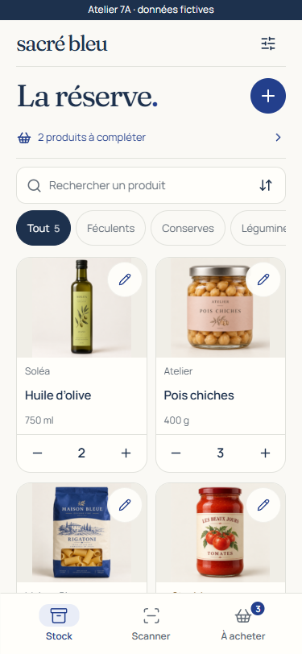
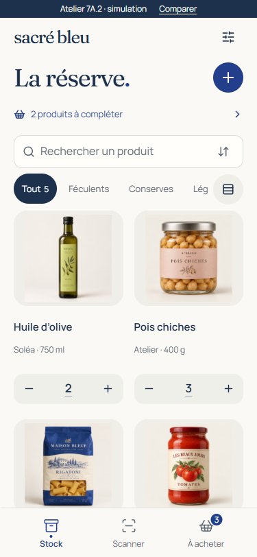
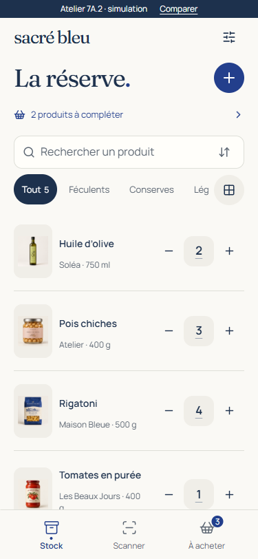
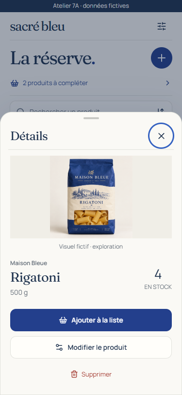
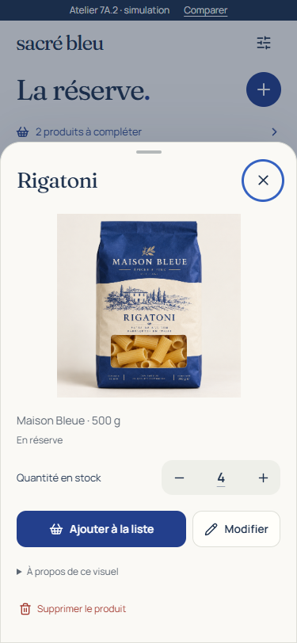
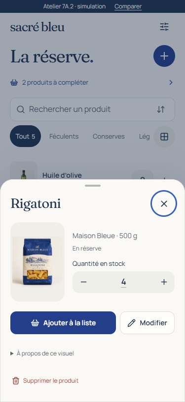
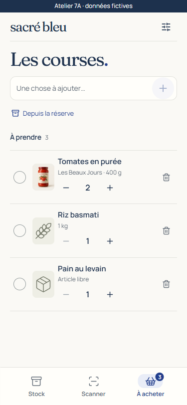
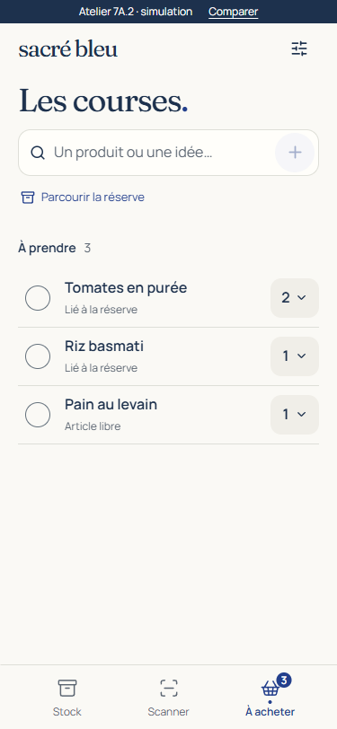
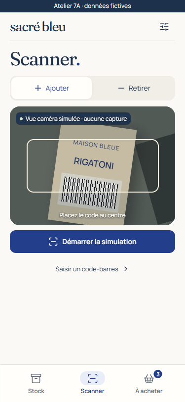
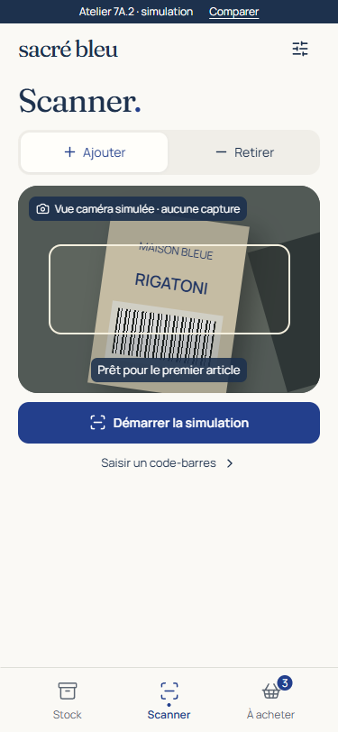

# 7A.2 · L’épicerie bleue — édition essentielle

**Design proposals for maintainer visual approval. PR #9 stays open against release/v1.1. No 7B/7C integration, merge or deployment.** Baseline: `8348e202cd6422fed6eff23f9ff1daa9c264b966`. See the [audit/execution checklist](PLAN.md) and [validation record](VALIDATION.md). The [capture index](SCREENS.md) links every requested size and state.

## Start with the interactive comparisons

```sh
npm ci
npm run dev:7a
```

Open **http://127.0.0.1:5197/compare.html**. Four tabs compare inventory, detail, shopping and scanner. On a wide screen the alternatives sit side by side; on a phone choose a proposal above the preview. Choose 320/375/430 px and studio/mixed fixtures. “Open full screen” allows unrestricted interaction. Each preview has its own disposable memory; switching comparison area/fixtures resets it. There is no backend/account/camera request or persistent preference.

The 7A.1 reference preserves its implementation, including known defects, in `baseline.tsx`, its original stylesheet and a frozen swipe hook. Only URL bootstrap/language/fixture selection was added. The shared review fixtures intentionally provide identical names, quantities and imagery across alternatives. Existing historical 7A/7A.1 captures are retained separately, not overwritten.

## Inventory: two different propositions

| 7A.1 reference                                      | A · Photographic shelf                  | B · Compact inventory                       |
| --------------------------------------------------- | --------------------------------------- | ------------------------------------------- |
|  |  |  |

**A** removes the framed card, pencil overlay and divided footer. The object, name, package and tactile stock control share one composition. Warning text remains ordinary readable content. Names can grow instead of being truncated; very long names increase a shelf row's height. Contain-fit preserves packaged goods and original label colours. The shelf has stronger photographic recognition, especially for visually similar packages, but spends more space on each object.

**B is the recommended everyday default.** A distinct horizontal list puts recognition, name and stock on the same row. The large, stable +/− targets remain direct; tapping the underlined quantity proposes a multi-unit **delta**, with confirmed stock and proposed result shown separately. It is faster to scan larger catalogues and less sensitive to narrow/low-resolution images. The in-memory display toggle exposes A without a persistent preference. The default does not change with viewport height.

At 375 × 812, B shows **three complete products with controls**, compared with two for A. At 390 × 844 and 430 × 932 it shows four. The shelf still exposes larger product imagery and remains a useful explicit option. At 320 × 568 the photographic shelf cannot fit a complete first card below its filters; this is a real trade-off, not hidden by a height-triggered replacement layout. B shows the first complete row and the following product. [Exact measurements](screenshots/measurements.json), [320 shelf](screenshots/shelf-320x568.png), [320 list](screenshots/compact-320x568.png), [whole comparison](screenshots/comparison-inventory.png).

Stock +/- and proposed multi-unit changes never adjust shopping. Counts change only after the simulated receipt. The small number transition also runs after confirmation and preserves button focus. Invalid proposed results (below zero, over 9999, fractional, zero delta) cannot be submitted. The local proposal applies one transform/receipt; production must use **one authorized atomic operation**, not a loop of single-unit calls. The existing shared client exposes +/-1; widening this is a separately reviewed integration decision, not implemented here.

## Details: object versus essential

| 7A.1 reference                                        | A · Object-led sheet                             | B · Essential split sheet                          |
| ----------------------------------------------------- | ------------------------------------------------ | -------------------------------------------------- |
|  |  |  |

The product name is the sheet title in both. Direct stock correction, explicit shopping addition and editing are available together; deletion is secondary and still separately confirmed. Attribution moves into an accessible disclosure and follows the actual image source. Personal overrides never inherit OFF credits; removing one restores the original credit.

**Recommend A, the object-led sheet**, for recognition and a more distinctive transition from the compact inventory. B places a small image next to metadata/stock and brings all actions closer together. B is credible for a task-focused alternative, not an automatic short-height mode. At narrow widths A stacks its action buttons, while B remains a different image/information composition. [Side-by-side comparison](screenshots/comparison-details.png).

Sheet entry uses a short transform/opacity transition. A cross-item shared-image morph was not added: native dialog focus, scrolling and imperfect image fit take precedence over a fragile cross-layer animation. That optional continuity experiment remains deferred.

Editing presents name/initial quantity first; all original metadata fields remain under “Product information.” Barcode from an unknown scan is prefilled and visible. Existing product edits preserve current stock. The photo section offers choose/replace/remove and contain/fill preview. A choice is remembered in this tab **after Save confirms**, never in persistent storage or the production Product model. Close/Escape on an unchanged form is silent; on a modified form it offers Continue/Discard while retaining the actual mounted draft. A failed save retains all fields and a classified error. Sticky save, focused-field clearance and VisualViewport fitting are tested at 460 px visible height; this does not certify the iOS keyboard.

## Shopping and replenishment

| 7A.1 shopping                                        | Unified entry / dominant checking          |
| ---------------------------------------------------- | ------------------------------------------ |
|  |  |

A single search/add input offers **explicit linked-product suggestions** with package identity and a separate free-text action. Typing an identical name and pressing + never infers an association. Search covers product name, brand and barcode; six results are shown initially with “Show more,” and Browse reuses this input. There is no second selector flow.

Checking is the main row action. The quantity/chevron button discloses +/− and Delete; no horizontal row swipe competes with page navigation. The checked-state transition starts only after a receipt. All V1 actions remain: check/uncheck, both quantity directions, deletion, clearing completed rows, linked accumulation and independent free text. Explicit quantity edits uncheck; checking retains quantity. [Completed state](screenshots/shopping-completed-375x812.png), [comparison](screenshots/comparison-shopping.png).

Deletion exposes context-specific Undo until another deletion replaces its slot or examples are reset. Restoration changes **only the removed row**, preserves unrelated changes, refuses a duplicate active linked row, and detaches a missing product reference. It is not a shared-state snapshot restore. Production requires an authorized idempotent compensation, current permissions/row/tombstone checks and receipt/current-snapshot verification. The in-memory proposal does not claim multi-user concurrency validation.

Replenishment opens a focused selection sheet rather than navigating to unrelated shopping rows. Defined-minimum shortages show existing/target stock and suggested quantities; already-linked unchecked rows are marked and disabled. Confirming selected entries rechecks current candidates and skips duplicates. Zero stock with **no minimum** is a separate section with no invented suggestion. No new zero-stock replenishment rule is approved. [Selection sheet](screenshots/replenishment-375.png).

## Scanner as a session

| 7A.1                                                | Session proposal                                |
| --------------------------------------------------- | ----------------------------------------------- |
|  |  |

Add/Remove stays at the same top position. Ready/scanning, detected/write-pending, confirmed, failed/correction and unknown are distinct. A detection only announces **pending**; a successful result identifies the product, signed processed total and confirmed stock. Correction and Undo sit with that result. Repeat and manual entry follow in the same DOM/visual order, and remain visible at **320 × 568 without scrolling**. [Small result](screenshots/scanner-result-320x568.png), [error](screenshots/scanner-error-375.png), [unknown Remove](screenshots/scanner-unknown-remove-375.png), [ready comparison](screenshots/comparison-scanner-ready.png), [result comparison](screenshots/comparison-scanner-result.png).

The total starts at one and uses `scanQuantityLimit()` from the real model. Remove at zero / Add at 9999 are refused before a simulated write. A confirmed result is announced once with identity, operation and stock; correcting the same operation does not repeat that full live announcement. Unknown Remove explicitly offers “Create without removal” or Return; it never silently changes mode or presents a removal receipt. Unknown Add requires form validation before create-at-zero + identified scan; Undo preserves the new zero-stock product.

Camera remains **a labelled scene simulation**. Repeat explicitly rearms it; a stationary barcode is never automatically counted twice. A real-camera integration must keep the video element/stream stable across presentation states, suspend recognition while showing/adjusting the held result, retain the existing presentation latch/intention UUID, and release tracks on page exit/background. Decoder crop/resolution, torch/lens controls, real OFF lookup and the live scanner contract are unchanged. The generic scene deliberately tests an uneven camera background instead of pretending a studio packshot is camera evidence.

## Gestures, imagery and accessibility

The real three-pane track follows the finger through an isolated **requestAnimationFrame + transform** path. Touchmove does not set React state or rerender catalogue cards. Neighboring content is real; inactive panes remain inert/aria-hidden. Each pane retains vertical position. Images and product names distinguish tapping from swiping. System edges (24 px), fields, controls, sheets, vertical/multitouch/canceled gestures, camera and pending/uncertain writes are guarded. Drafts block only their current interaction page; leaving a shopping/manual draft does not block Stock swipes. [Continuity capture](screenshots/swipe-continuity-375.png).

The test records 100/300-product filter and gesture script/layout costs in [performance.json](screenshots/performance.json). These are single local Chrome samples, not iPhone frame-rate or low-end-hardware acceptance. No virtualization is justified yet; the heavy inventory tree remains mounted for adjacent-pane continuity, images decode lazily, and touch animation is detached from React. A larger backend catalogue needs profiling on target hardware before choosing virtualization. Review assets remain large PNG/TTF originals; production formats/subsets are deferred.

Mixed imagery includes studio pouch/jar/bottle, genuine white-background OFF images, a 75 × 200 can, explicitly labelled poor-crop presentation, a fictional personal kitchen photograph, missing/failed images, a long product name, 9999 stock and metadata-free zero. No global blend/filter recolours labels. The crop fixture clips its presentation deliberately; its underlying attributed public binary is unchanged. Contain-fit is the packaged-good default. [Mixed](screenshots/mixed-375x812.png), [long name](screenshots/long-name-375x812.png), [personal preview](screenshots/photo-preview-375.png), [OFF credit](screenshots/off-attribution-375.png). The [photo proposal](../PHOTOS.md) now covers large mobile inputs and HEIC/HEIF failure/conversion considerations; no Storage implementation exists.

Fallback text and unchecked selection outlines have measured contrast targets, inputs are at least 16 px, controls retain 44 px targets and native keyboard interaction. Enlarged supporting/control text grows the bottom bar and reserves its actual height instead of clipping labels. [Enlargement stress](screenshots/text-enlargement-375.png), [English shopping](screenshots/english-shopping-375.png), [landscape](screenshots/landscape-812x375.png). Reduced motion disables transitions/animation. Haptics are not invoked; their absence is the graceful fallback, not an iOS haptic test.

## Focused review walkthrough

1. Compare inventory A/B at 320 and 375 with the same fixtures. Toggle to mixed conditions. Open the long-name and zero-stock entries.
2. Open a product. Compare object and essential detail compositions. Adjust +/-1, then tap the quantity and propose +12. Observe the original count during pending. Settings → failure on next save confirms that failed changes never appear successful.
3. Edit a field, Close → Continue. Verify the draft. Open optional metadata/photo, choose a large JPEG/PNG/WebP, change framing, Save; reopen and remove. An unsupported HEIC explains the conversion path.
4. In shopping type “Tomates.” Select the catalogue suggestion; repeat with the same name using the free-text action. Check, open quantity/options, edit, remove, Undo and clear completed.
5. Open replenishment from Stock. Existing linked rows are marked; choose another shortage, confirm once, verify no duplicate.
6. Scan in both modes. Observe pending/result, correct total, Undo, explicitly repeat. Enter an unknown code in Remove: no removal occurs. Settings demonstrates offline, uncertain verification, conflict and unexpected errors without real connectivity claims.
7. Leave drafts on shopping/manual entry, return to Stock and swipe across a photograph/name. Return to the drafts. Test keyboard/reduced-motion mode separately.

## Approval decisions and integration boundaries

Please choose **B list default + optional A shelf**, **A object detail versus B essential**, unified shopping with disclosed secondary actions, the proposed delta control, and explicit scan rearming. The large-name shelf trade-off and removal-Undo lifetime merit product review. These are recommendations, not approved requirements.

Deferred to a separately authorized **7B**: transplant selected presentation components into V1, map every action to existing authorized receipts/concurrency/uncertain recovery, review one-operation multi-unit stock support, implement safe shared removal compensation, integrate existing real camera/lookup controls, and optimize image/font payloads. Deferred to **7C/device acceptance**: physical Safari/iPhone/Android/PWA keyboard/safe areas/system gestures, VoiceOver/TalkBack, real camera repeat/torch/lens behavior, low-end performance and optional haptics. Private shared photos, HEIC processing and archive/restore remain a separately approved feature; no phase is started by this document.
